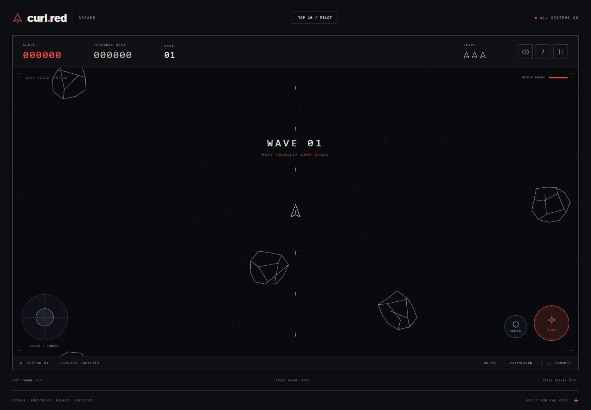
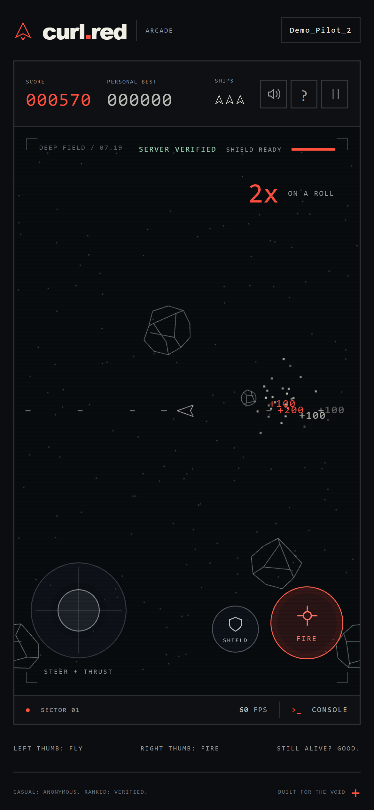

# Asteroid Drift

A browser arcade built with Three.js, Node.js, and SQLite. Play with a keyboard, touchscreen, or controller; choose a local casual game or a ranked flight with server-computed scores.

[](https://github.com/false00/asteroid-drift/actions/workflows/ci.yml)
[MIT license](LICENSE)

**[Play](https://curl.red/)** | [Run locally](#run-locally) | [Architecture](#architecture) | [Verification](#verification)



## The game

Wireframe asteroids split into smaller rocks, waves build, and consecutive hits raise the score multiplier. Pickups, rechargeable shields, procedural audio, and controller feedback accompany the flight.

| Mode | Behavior |
| --- | --- |
| Casual | Browser-local simulation, a personal best, and seven optional cheats. Sandbox scores remain separate from normal records. |
| Ranked | Passkey sign-in, live server simulation, an account-wide personal best, and a global top ten with one best score per account. Local and sandbox results cannot be imported. |

The renderer uses reusable geometry and typed GPU buffers. Viewport projection, including portrait play, is separate from the game model. Runtime assets and modules are self-hosted.

Personal records and leaderboard overtakes earn orbital bursts, score highlights, and distinct synthesized fanfares without blocking flight controls. Live ranked pace is marked provisional; the result screen confirms records only after the server commits them. Reduced-motion preferences retain the record text without animation. The primary action after a ranked result launches another ranked flight; casual play remains a separate choice.

Interrupted ranked flights offer a connection retry or an explicit new flight. Retrying preserves the unfinished run when it is still available; starting over discards only that account's expected unfinished flight. Saved personal and public records are unchanged. Restart requests share the authenticated, exact-origin, CSRF and rate-limit boundaries of starting a flight, and abandonment plus the fresh checkpoint commit atomically.

## Architecture

```text
Browser
  Three.js rendering, input, audio
       |
       +-- HTTPS: passkey authentication, account operations, top ten
       |
       +-- WebSocket: controls -> simulation
                      snapshots/events <- game state
                                      |
                                Node.js + Fastify
                                      |
                                  SQLite WAL
                         accounts / runs / scores / outbox
```

### Controls are input, not authority

Ranked clients send quantized controls at up to 30 Hz. The server owns time, randomness, movement, collisions, lives, and scoring, running the simulation at 120 Hz and sending snapshots at 20 Hz. The browser interpolates wrapped positions for rendering.

The arena follows the available playfield on phones and desktops. Its total area and object scale are normalized, and viewport changes are validated and rate-limited by the server. Rotation, window resizing, and device handoff preserve the same flight and progress; layout changes do not award scores or reset lives and timers. Control sequences remain checked per connection. Arena shape can affect play; resizing is a permitted game input, not a source of client-provided scores or time.

Client-supplied scores, positions, elapsed time, seeds, and cheat flags are rejected. Websocket attachment requires a short-lived, single-use ticket bound to the session and run; tickets travel in the first message rather than the URL.

### Account ownership is independent of public handles

An immutable account ID owns passkeys, sessions, and scores. Public handles are display data: 3-20 ASCII letters, digits, or underscores, with case-insensitive uniqueness and strict validation. They are never paths, SQL identifiers, or authorization rules.

SimpleWebAuthn verifies signatures, user verification, RP ID, origin, and expiring single-use challenges. Sessions use hashed opaque tokens and `Secure`, `HttpOnly`, `SameSite=Strict`, `__Host-` cookies. Mutations also require exact-origin and CSRF checks. Backup-key enrollment and account deletion require recent passkey verification.

Aliases are encrypted with AES-256-GCM and account-bound associated data. Case-insensitive lookup uses HMAC under a separately derived key, avoiding plaintext name indexes.

### Results and audit records commit together

SQLite WAL transactions finalize the server result, update and prune the top ten, and enqueue the audit event together. A score is reported as saved only after the transaction succeeds. Storage failures disable mutations rather than returning a successful-looking result.

Each account retains one private verified-best number, independent of the ten public leaderboard rows. It follows the passkey account across devices and is updated in the same finalization transaction. The HUD separates this ranked record from the browser-local casual best; neither local storage nor sandbox totals can update it. Existing databases initialize account bests from retained leaderboard entries, not from untrusted browser scores or discarded score history.

Account activity and authoritative run summaries enter an encrypted, HMAC-chained outbox. A bounded local management CLI exports ciphertext for downstream processing. Authentication assertions, challenges, session cookies, and attachment tickets are excluded from logs.

Casual metrics are a separate stream: they qualify after trusted control activity and two active seconds, not a page view. They are not used to verify ranked scores.

### Resource and serving boundaries are explicit

Requests and websocket messages have strict schemas, size limits, and rate budgets. Static serving uses an asset allowlist; CSP restricts scripts, connections, and framing. Production requires TLS 1.3, and forwarding headers are ignored unless an explicit trusted proxy is configured.

The backend is a single process with eight playing rooms and sixteen total rooms. Active play has no duration cap, but missing input, stalled scheduling, slow receivers, and disconnected runs have bounded behavior. Checkpoints and graceful shutdown preserve unfinished runs; an unexpected crash can lose up to 30 seconds of unfinished progress.

Encrypted connection diagnostics retain close codes, server close decisions, bounded queue/message counts, and last-message timing. Allowlisted pause reasons distinguish manual controls from focus loss, hidden tabs, and game menus. Raw socket-close text, attachment tickets, and input payloads are not recorded. A missing close frame is classified as an unattributed transport loss, not proof that the browser or network caused it.

Ranked sockets send protocol-level keepalives every 15 seconds, including while paused. Missing pong responses request a diagnostic closure after 45 seconds without changing the paused flight's ten-minute recovery lease. Connection IDs correlate server ping/pong round trips, scheduling gaps, tick execution time, snapshot sizes, and output queues with browser reports.

Bounded browser reports include rendered-frame gaps, long tasks where supported, snapshot and input gaps, acknowledged-input backlog, drawing-buffer dimensions, coarse browser/network categories, visibility/focus/connectivity transitions, and the browser's close code. Reports use a 4 KiB authenticated same-origin/CSRF-protected endpoint, with per-account rate limits and a memory-only queue of at most eight reports for ten minutes. They are best-effort operational hints, not score authority or proof of which network hop failed. Client clocks may differ from server time; unsupported measurements are explicitly marked. Raw errors, stacks, URLs, user-agent strings, and control payloads are excluded.

Audit consumers with explicit event allowlists must accept `ranked.connection_diagnostics` before deploying this producer. Keep these reports inside the existing private encrypted audit path and exclude them from qualified-play and terminal-score totals. No new diagnostic data is exposed through the public leaderboard or health endpoint.

## Run locally

Requires **Node.js 24+**, npm, and a WebGL2-capable browser. SQLite uses a native module; platforms without a matching prebuilt binary need a C++ build toolchain and Python.

```sh
git clone https://github.com/false00/asteroid-drift.git
cd asteroid-drift
npm ci
npm run dev
```

Open **http://localhost:8080**. The development server binds to loopback, generates a local master key, and keeps its database and key in ignored `data/`. Local accounts and the ranked simulation are enabled.

Use a current Chromium browser for the simplest localhost passkey flow. Browser/OS passkey support varies; production always requires HTTPS. Set `DEV_PORT` to use another local port.

## Verification

```sh
npm run build
npm test
npx playwright install chromium webkit
npm run test:browser
```

Tests cover simulation rules, rejected input shapes, origin and CSRF enforcement, cryptographic verification, storage failures, replay handling, and account lifecycle. Chromium and WebKit profiles exercise keyboard, multitouch, controller, fullscreen, and responsive rendering behavior.

Set `PLAYWRIGHT_CAPTURE=0` to disable screenshots and traces during browser checks. Fullscreen checks verify canvas pixels, device-density drawing-buffer dimensions, and pointer/keyboard HUD behavior without image capture.

The browser integration suite registers a resident passkey through a Chromium virtual authenticator, moves the same ranked flight between desktop and phone layouts, rejects a forged score, restarts against the same database and key, signs in again, and deletes the account with fresh proof. Signature verification remains part of the test.

CI runs locked installs, the client bundle build, and both test suites on hosted runners with read-only repository permissions. Tests use isolated state and require no production credentials.

## Controls

| Action | Keyboard | Touch / standard controller |
| --- | --- | --- |
| Steer | A/D or Left/Right | Left thumbstick / left stick |
| Thrust / brake | W/S or Up/Down | Push/release thumbstick / stick or X |
| Fire | Space | FIRE / A or right trigger |
| Shield | Shift | SHIELD / B or right bumper |
| Pause | P or Escape | Toolbar / Start |
| Fullscreen | F; Escape exits | Desktop native Fullscreen API |
| Cheats | Backquote or CONSOLE | CONSOLE; casual mode only |



Screenshots use local gameplay and a local demo account.

Touch controls use independent pointers, safe-area layout, and screen-relative steering. Controller support includes a circular dead zone, neutral latching, and pause-on-disconnect. Fullscreen is desktop-only; rumble and haptics depend on browser and device support. iPhone Safari does not expose the required vibration/controller-actuator APIs.

A detected controller hides the touch controls. Touching the playfield restores them and suppresses any held controller input until the pad returns to neutral; new controller input switches back. Disconnecting a controller restores the touch interface, and an active controller flight still pauses safely on removal. Touch auto-braking does not apply while the controller interface is active.

Native fullscreen removes page padding and borders so the game fills the complete display. Rendering uses device pixel density, bounded only by WebGL texture/renderbuffer/viewport limits; windowed rendering retains its existing 2x density cap. Score and utility controls float on transparent backgrounds and remain visible without an idle timeout. Shield charge, remaining power-up duration, ranked status and the server connection indicator stay on screen. Escape or F exits fullscreen without ending the flight.

The ranked connection strip displays measured WebSocket round-trip latency in milliseconds, updated by heartbeat pongs even while paused. It shows `-- ms` until the first measurement and clears old measurements on disconnect, reconnect, or after 45 seconds without a fresh sample. Connection state remains visible during recovery; latency measurements never affect scoring or gameplay authority.

## Operating notes

Server authority does not prevent automation that produces valid controls, and passkeys do not establish that accounts belong to unique people. There is no password or email-recovery path; keep a backup passkey.

Leaderboard aliases are public. Protected audit records include aliases and client IPs; delivery, access, retention, backups, and host/network policy are operator responsibilities. Preserve the database and matching master key together. The outbox is finite, so delivery failures require attention.

<details>
<summary>Production configuration</summary>

`npm start` reads explicit environment variables. It does not load an environment file or generate production keys.

| Variable | Purpose |
| --- | --- |
| `PUBLIC_ORIGIN` | Required exact HTTPS origin, such as `https://arcade.example`, without a trailing slash; determines the WebAuthn RP and connection policy |
| `DATABASE_PATH` | Required application database path with a private parent directory |
| `MASTER_KEY_FILE` | File containing exactly 32 random bytes |
| `TLS_KEY_FILE`, `TLS_CERT_FILE` | TLS private-key and certificate files |
| `CREDENTIALS_DIRECTORY` | Alternative directory containing `master-key`, `tls-key`, and `tls-cert` |
| `BIND_HOST`, `PORT` | Defaults: `127.0.0.1`, `8443` |
| `AUTH_ENABLED` | Defaults to `0`; enable after configuring identity, privacy, and storage |
| `TRUSTED_PROXY_IP` | Optional single trusted peer; unset for direct TLS |
| `CLIENT_IP_HEADER` | Trusted-proxy mode only: `x-forwarded-for`, `x-real-ip`, or `cf-connecting-ip`; accepts one validated address |
| `REDIRECT_HOST` | Optional hostname/port redirected to the canonical origin before authentication |

The [management CLI](server/admin.mjs) requires an explicit `DATABASE_PATH` and exports bounded ciphertext batches. It is not exposed over HTTP.

</details>

## Source map

| Location | Responsibility |
| --- | --- |
| [Game model](web/site/engine.mjs) / [renderer](web/site/arcade.mjs) | Simulation rules, geometry, input integration, and viewport projection |
| [Arena geometry](web/site/arena.mjs) | Shared viewport validation and normalized ranked dimensions |
| [Ranked client](web/site/ranked-client.mjs) / [run manager](server/runs.mjs) | Control protocol, interpolation, room lifecycle, and authoritative results |
| [API](server/server.mjs) / [configuration](server/config.mjs) | Authentication, request boundaries, static serving, and runtime configuration |
| [Store](server/store.mjs) / [cryptography](server/secrets.mjs) | Transactions, account-bound encryption, lookup, and audit integrity |
| [Browser tests](web/test/) / [backend tests](server/test/) | Gameplay, protocol, identity, persistence, and failure-path coverage |

## License

[MIT](LICENSE). Vendored Three.js and SimpleWebAuthn browser code retain their upstream MIT licenses in [web/site/vendor/](web/site/vendor/). Dependency audits do not replace reviewing or updating vendored browser libraries.
